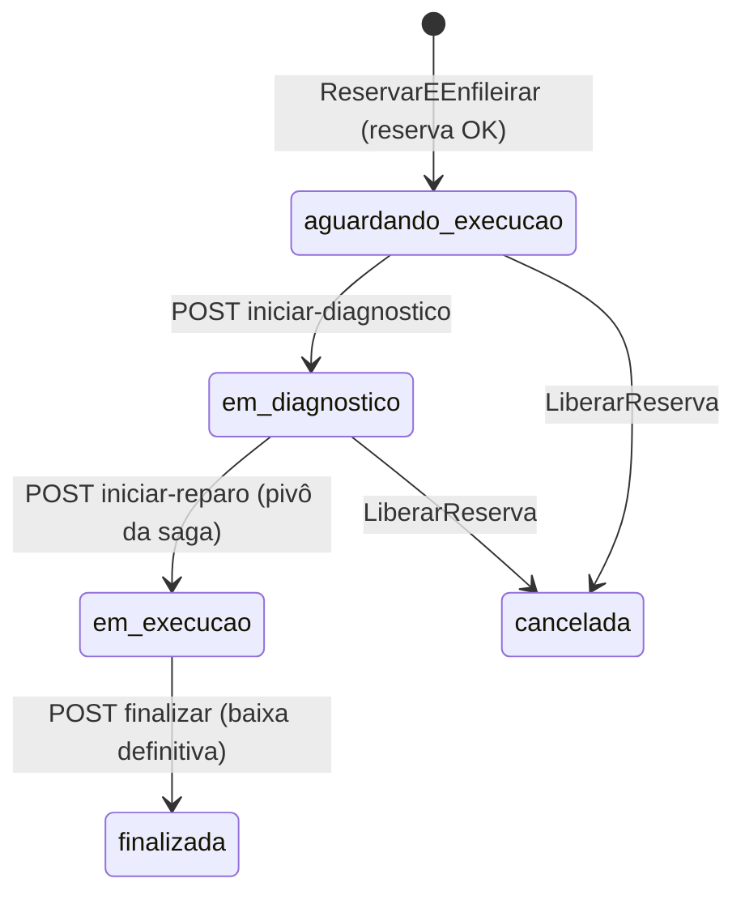

# fiap-officine-execution-service

[](https://sonarcloud.io/summary/new_code?id=fiap-officine_fiap-officine-execution-service)
[](https://sonarcloud.io/summary/new_code?id=fiap-officine_fiap-officine-execution-service)

Microsserviço de **execução**: estoque de peças, fila de execução, diagnóstico e
reparo. Banco **NoSQL (DynamoDB)**. Participante da saga orquestrada pelo
[os-service](https://github.com/fiap-officine/fiap-officine-os-service).
Tech Challenge SOAT — Fase 4.

| | |
|---|---|
| Responsabilidades | Saldo e reserva de estoque, fila de execução priorizada, diagnóstico → reparo → finalização, baixa definitiva e alerta de estoque mínimo |
| Banco | DynamoDB: `execucoes` (single-table) e `estoque` |
| Consome | `execution-commands`: `ReservarEEnfileirar`, `LiberarReserva` (compensação) |
| Publica | `os-saga-replies`: `ExecucaoAgendada`, `ReservaFalhou`, `ReservaLiberada`, `DiagnosticoIniciado`, `ReparoIniciado` (pivô), `ExecucaoFinalizada` |

## Por que DynamoDB

- **Reserva atômica e idempotente** com `TransactWriteItems`: para cada peça
  `SET disponivel = disponivel - :q, reservada = reservada + :q` com
  `ConditionExpression disponivel >= :q`, mais o item de idempotência `MSG#`
  (`attribute_not_exists`), o estado da execução e a resposta no outbox — tudo
  ou nada. Se alguma condição de estoque falha, o serviço responde
  `ReservaFalhou` com as peças faltantes.
- **Acesso chave-valor**: execução por OS, linha do tempo por OS e fila por status.
- Gerenciado e on-demand: não consome memória do nó K3s.

## Modelo

Tabela `execucoes`:

| PK | SK | Atributos | Uso |
|---|---|---|---|
| `OS#123` | `META` | status, prioridade, pecas, servicos, mecanico, datas, saga_id | estado atual |
| `OS#123` | `EVT#<ts>#<id>` | tipo, observacao, mecanico | linha do tempo |
| `MSG#<message_id>` | `MSG` | processed_at, `ttl` | idempotência (TTL 7 dias) |
| `OUTBOX#<message_id>` | `OUTBOX` | envelope | respostas a publicar |

GSI `fila-por-status`: `GSI1PK = FILA#<status>`, `GSI1SK = <prioridade>#<enfileirado_em>#<os_id>`
→ fila ordenada (alta → normal → baixa, depois ordem de chegada). Os itens do
outbox usam o mesmo índice como índice esparso (`GSI1PK = OUTBOX`).

Tabela `estoque`: `PK = PECA#<id>`, `disponivel`, `reservada`, `estoque_minimo`
(o `peca_id` é o do catálogo do OS Service).

## Ciclo de vida da execução



## Outbox sem banco relacional

As respostas para o orquestrador entram como itens `OUTBOX#` **no mesmo
`TransactWriteItems`** que altera estoque/fila. Um relay consulta o índice
esparso, publica no SQS e apaga o item. Assim, nenhuma resposta se perde se o
processo cair entre o commit e o publish.

## API

Swagger: `/execution/docs` · [docs/openapi.json](docs/openapi.json). Todas as rotas exigem
JWT de operador (`role=admin`, emitido pelo OS Service).

| Método | Rota | Descrição |
|---|---|---|
| GET | `/api/v1/execucoes/fila?status=` | Fila ordenada |
| GET | `/api/v1/execucoes/{os_id}` | Estado + linha do tempo |
| POST | `/api/v1/execucoes/{os_id}/iniciar-diagnostico` | → `DiagnosticoIniciado` |
| POST | `/api/v1/execucoes/{os_id}/iniciar-reparo` | → `ReparoIniciado` (**pivô**) |
| POST | `/api/v1/execucoes/{os_id}/finalizar` | baixa das peças + `ExecucaoFinalizada` |
| PUT | `/api/v1/estoque/{peca_id}` | Entrada de estoque / estoque mínimo |
| GET | `/api/v1/estoque` · `/{peca_id}` | Saldos |
| GET | `/execution/health` | DynamoDB e SQS |

## Rodando e testando

```bash
docker compose up --build     # LocalStack (DynamoDB + SQS) + execution-service
uv run pytest                 # moto (DynamoDB/SQS); falha abaixo de 80%
```

Cobertura atual: **93%** (branch coverage).

## CI/CD e infra

- [ci-cd.yml](.github/workflows/ci-cd.yml): lint → testes (≥80%) → SonarCloud →
  ECR (tag SHA) → Kustomize + `rollout status` → smoke test.
- [infra/](infra/) (Terraform): tabelas DynamoDB (GSI + TTL), fila
  `execution-commands` + DLQ e política IAM restrita às próprias tabelas.
